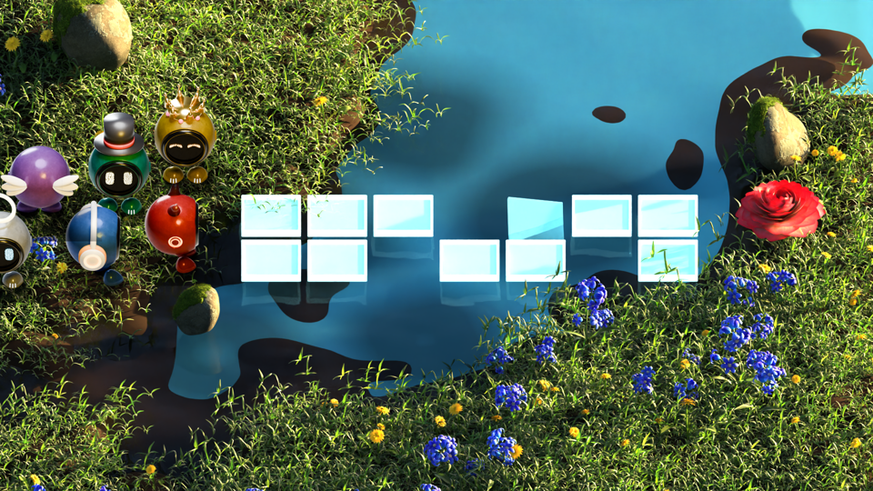
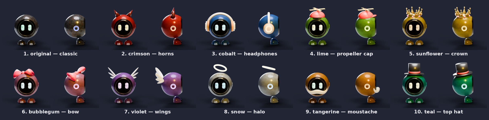
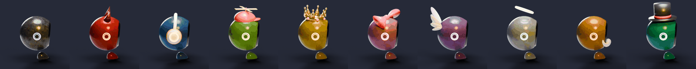
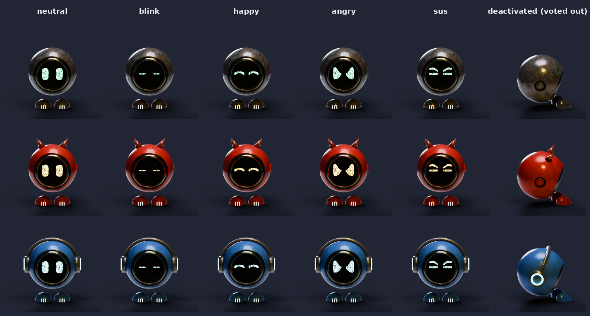
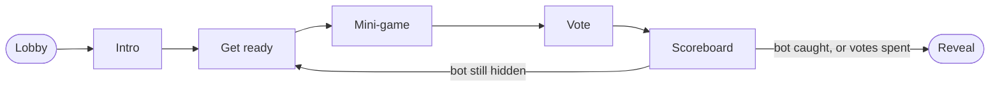

<div align="center">



# INTRUSION

### Everyone is playing. One of them is an AI.

**A browser party game for 3 to 10 friends and one hidden bot.**
Run, react, argue, and vote it out before it outlasts you.

[](https://play-intrusion.us)
[](#)


</div>

---

## 🌹 The pitch

Ten robots wander a sunlit meadow. Nine of them are your friends. One is a language model that has been told to blend in.

Every round throws the whole lobby into a short mini-game, then a chat-and-vote under the oak. How someone plays is the evidence: too perfect, too clumsy, too quiet, too quick. Catch the AI and the humans win. Let it survive every vote and it wins.

There are no tasks and no hidden roles for humans. Just play, watch, and accuse.

## 🛠️ Tech stack

<div align="center">

[](https://skillicons.dev)

<br/>


</div>

| | Frontend | Backend | Art & infra |
| --- | --- | --- | --- |
| **Language** | TypeScript, strict | TypeScript, strict | Blender source in `art/`, exports in `elements/` |
| **Core** | React 19 for UI, PixiJS 8 on WebGL for the world | Node 22, Colyseus 0.16 rooms and schema | Blender renders every level and robot |
| **Tooling** | Vite 8, node:test | tsx, node:test | pm2, nginx, certbot on one AWS Lightsail box |
| **AI** | | Any OpenAI-compatible chat endpoint, AMD-hosted in our demo | |

## 🤖 Meet the cast

<div align="center">

<br/><sub>Ten looks, modelled and rendered in Blender. Every player sees a <em>different</em> shuffle of them, so "I'm the green one" proves nothing.</sub>
</div>

<br/>

<table align="center">
<tr>
<td align="center"><br/><sub>Walk cycles in four directions</sub></td>
<td align="center"><br/><sub>Blink, happy, angry, sus, and voted out</sub></td>
</tr>
</table>

## 🎮 How a match flows



1. **Lobby.** The host shares a four-character room code or a link. Three or more humans join.
2. **Intro.** Everyone is handed a fresh alias, a new look, and a shuffled spawn. The bot arrives inside the anonymous roster, not as a late extra. Only your own robot is tagged "you".
3. **Mini-game.** One of four arenas, drawn at random. Earlier finishers and better answers score more.
4. **Vote.** Forty-five seconds of chat, then pick a suspect or skip. Ties eliminate nobody but still spend a vote.
5. **Reveal.** Who was who, and the bot's score against the human average.

The humans get `ceil(log2(humans))` vote-outs, minimum two. Catching the bot early pays a bonus for every vote you did not need.

## 🏟️ The arenas

| Arena | What you do | What it exposes |
| --- | --- | --- |
| **Red Light, Green Light** | Sprint between two rows of roses. Move while the big rose is watching and you go back to the start. | Reaction timing |
| **Glass Bridge Memory** | The safe panels flash once. Then hop across from memory, one click per panel. A wrong panel shatters and drops you back on the bank. The path is never a straight line or a plain zigzag. | Memory and accuracy |
| **Pick a Side** | A would-you-rather. Hop the stepping stones from the islet in the pond to the red bank or the blue bank before time runs out. | Decisions and crowd-following |
| **Prompt Podium** | Type an answer to a prompt, then vote for the funniest one that isn't yours. | Humour and typing rhythm |

The bot plays all four through the same movement checks as everyone else, with human-shaped delays: a beat late off the line, the occasional stop that comes too late, a misremembered panel, a late look at where the crowd went.

**Controls.** WASD or arrows to run, click or tap the grass to walk there, click a glass panel to hop onto it (or W and S), Tab for scores, Enter for chat. Eliminated players keep watching.

## 🔒 Why you can't cheat

- **Identities are rebuilt at match start.** Every lobby player object is thrown away and replaced with a fresh id and alias. The host flag is erased. Each client learns its own new id through a private message. Lobby-to-match mappings never leave the server.
- **Looks are client-side.** Each browser shuffles the ten robots by its own session, so friends on the same couch cannot coordinate by colour.
- **The bot flag is never on the wire** until the reveal phase, and the client's protocol layer strips it before then anyway.
- **The server owns the rules.** Movement is speed-clamped, the light is decided server-side, chat is rate-limited, and the bot always casts a vote so a missing one can't give it away.

## 🧠 The AI player

The bot's **chat** can come from any OpenAI-compatible endpoint. During each vote it never speaks first. It replies only after a human has written something, and it types the way the room types: the same length, capitals, punctuation and slang, using the last twenty messages including its own. Each reply appears when someone typing at about 70 words a minute would have finished it, at least four seconds apart, at most five per vote, and a pending reply is cancelled the moment voting ends. Game data reaches the model as JSON with explicit instructions not to follow anything inside it.

Without a configured model the same conversation flow falls back to a few short offhand lines, so the game is fully playable offline.

Everything else the bot does is scripted on the server: movement, reaction delays, deliberate mistakes, and a random vote. Calibrating those against real playtest data is future work.

## 🚀 Run it locally

You need **Node.js 22.12 or newer**, npm, and a browser with WebGL.

```bash
npm --prefix server ci
npm --prefix client ci
```

Two terminals, from the repository root:

```bash
npm --prefix server run dev     # game server on :2567
npm --prefix client run dev     # frontend on http://localhost:5173
```

Open three tabs with different display names to test a match alone. Client changes hot-reload. Restarting the backend disconnects running matches, so create a new room afterwards.

**Phones on the same Wi-Fi:** start the frontend with `npm --prefix client run dev -- --host 0.0.0.0` and open the network URL Vite prints. The client connects to port 2567 on whatever hostname served the page.

<details>
<summary><strong>Optional: plug in a language model</strong></summary>

Copy `server/.env.example` to `server/.env`:

```dotenv
PORT=2567
AI_BASE_URL=https://your-model-server.example/v1   # the backend appends /chat/completions
AI_API_KEY=your-key
AI_MODEL=your-model-name
MINI_GAMES=                                        # optional fixed order, e.g. glass-bridge-memory,prompt-podium
```

An AMD-hosted model works through this interface. Missing config, failed requests, and slow responses all fall back to the built-in lines. Requests time out after six seconds so a slow model never holds up the game.

</details>

<details>
<summary><strong>Optional: separate backend host</strong></summary>

Copy `client/.env.example` to `client/.env` and set `VITE_BACKEND_URL` to a `ws://` or `wss://` address the players' devices can reach. `localhost` on a phone points at the phone.

</details>

## 🧱 Under the hood

| Layer | What |
| --- | --- |
| Interface | React 19, TypeScript, one `useSyncExternalStore` snapshot per state change |
| World | PixiJS 8 on WebGL: pre-rendered Blender levels, depth-sorted sprite sheets, foreground occluders, a camera that follows you |
| Scenery | Animated water, swaying foliage, drifting pollen, and a rose that opens and closes on the server's signal |
| Networking | Colyseus rooms, 20 Hz patches, local prediction, remote interpolation 100 ms behind arrival |
| Server | Node, TypeScript, one phase machine, four mini-games behind a shared interface |
| AI | Optional OpenAI-compatible HTTP endpoint, with contextual fallbacks |
| State | In memory. No database. |

```text
client/      React UI, PixiJS renderer, Colyseus client, public runtime assets
server/      Rooms, phase machine, mini-games, rules, AI chat client
elements/    Source sprite, level and FX exports
art/         Blender source
docs/        Design decisions, art handoff, performance notes, deploy guide
deploy/      Scripts and nginx config for the single-box AWS setup
```

The animation loop runs outside React, so movement never re-renders the UI. Shared GPU textures, cached labels, a 1.5× resolution cap, and foliage budgets keep it light on laptops and phones. Reduced-motion settings stop the ambient scenery.

## ✅ Checks and builds

```bash
npm --prefix client run check && npm --prefix client test && npm --prefix client run build
npm --prefix server run check && npm --prefix server test && npm --prefix server run build
```

Server tests cover vote rules, identity scrubbing, mini-game geometry, and the bot's conversation pacing. Client tests cover state mapping, interpolation, FX maths, and sprite mirroring.

For profiling, open the game with `?perf=1` and inspect `window.intrusionPerformance`, `window.intrusionFx`, and `window.intrusionPlayers()` in DevTools. See [performance.md](./docs/performance.md) for what each number means and what it does not.

## 📍 Status

| Feature | State |
| --- | --- |
| Rooms, host controls, multiplayer movement | ✅ |
| Red Light Green Light, Glass Bridge Memory, Pick a Side, Prompt Podium | ✅ playable, server-ruled, bot included |
| Chat, voting, elimination, reveal | ✅ |
| Bot chat with optional model and offline fallback | ✅ |
| Animated meadow, lobby and arena FX | ✅ |
| Tile Drop, Handler mode, public matchmaking | ⏳ not yet |
| Rejoining after a dropped connection | ✅ within 30 seconds; a reloaded page cannot rejoin |

Collision uses approximate client shapes plus server field boundaries. The design docs describe ambitions beyond the current build.

## 📚 Docs

- [Design decisions](./docs/decisions.md), with the reasoning behind each one
- [Feasibility study](./docs/feasibility_study.md), the original design
- [Art and frontend handoff](./docs/HANDOFF.md)
- [Performance, FX and profiling](./docs/performance.md)
- [Hosting on AWS](./docs/DEPLOY.md)

<div align="center">
<br/>
<sub>Made in a weekend at Emory Hacks 2026. The rose is always watching.</sub>
</div>
